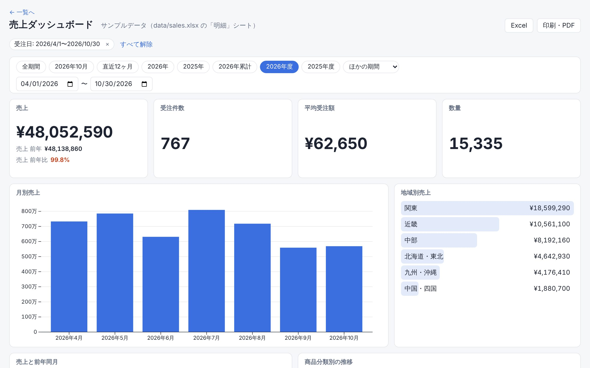

---
# The top page of the documentation site (https://ishibashi0112.github.io/devbi/). The front matter is VitePress's.
layout: home
title: DevBI
titleTemplate: 開発者が自社アプリ・社内システムに組み込む、コードで管理する BI

hero:
  name: DevBI
  text: 開発者が自社アプリ・社内システムに組み込む、コードで管理する BI
  tagline: ダッシュボードは git のファイル。タイルは JSX に「昇格」でき、集計はブラウザの中の DuckDB-wasm。MIT ライセンス。
  actions:
    - theme: brand
      text: はじめる
      link: /reference#はじめるcreate-devbi
    - theme: alt
      text: ライブデモ
      link: /demo/
      target: _self
    - theme: alt
      text: GitHub
      link: https://github.com/ishibashi0112/devbi

features:
  - title: ダッシュボードは git のファイル
    details: 指標と軸は metrics.yaml、タイルの並びは dash.json。差分で読み、レビューして、マージできます。VS Code で補完と型が効きます。
    link: /reference#metricsyaml
    linkText: ファイルの書き方
  - title: タイルは JSX に昇格できる
    details: 棒・折れ線・KPI・表・ピボット・明細の探索などの組み込みタイルで足りないところだけ、React で書きます。受け取るものは組み込みタイルと同じで、クリックでの絞り込みもそのままです。
    link: /reference#自作タイルjsx
    linkText: 自作タイル
  - title: 集計はブラウザの中
    details: Excel・CSV・Arrow を、ブラウザの中の DuckDB-wasm が集計します。ビルドしたものは静的なサイトなので、社内の Web サーバーにそのまま置けます。
    link: /deploying#1-静的なサイトとして置く
    linkText: 静的なサイトとして置く
  - title: 社内のデータベースから読む
    details: SQL Server・Oracle・PostgreSQL・MySQL・SQLite を、読み取り専用の API から読みます。重い集計は毎朝のスナップショットにできます。
    link: /reference#データベースから読むdevbiserver
    linkText: データベースから読む
  - title: 自社アプリに埋め込む
    details: script タグ 1 本でほかの画面に、React の部品として、ASP.NET（Core と .NET Framework）や Next.js のアプリに置けます。
    link: /reference#ほかのアプリの画面に埋め込む
    linkText: 埋め込む
  - title: GUI でも AI でも作れる
    details: 開発サーバーの GUI エディタでタイルを並べると、手書きと同じ dash.json に保存されます。AGENTS.md の手順で、AI にデータを調べてから作らせることもできます。
    link: /reference#gui-エディタdevbieditor
    linkText: GUI エディタ
---



<p class="caption">create-devbi で作られるサンプルの売上ダッシュボード（架空のデータ）。期間のボタンや、棒・行を押すと、ほかのタイルがその値で絞られます。</p>

## はじめる

```sh
npm create devbi@latest my-reports
cd my-reports
npm install
npm run dev     # http://localhost:5173 。見出しの右の「編集」で GUI エディタ
```

サンプルの売上ダッシュボード（架空の受注明細の Excel）が入ったプロジェクトができます。`data/` に自分の Excel や CSV を置き、`models/` の指標と `dashboards/` のタイルを書き換えていきます。続きは[リファレンス](reference.md#はじめるcreate-devbi)にあります。

## 向いているとき

- 社内の Excel の定期集計を、ブラウザで見られるダッシュボードにしたい
- 自社のアプリや社内システムの画面に、集計のグラフや表を置きたい
- ダッシュボードを、コードと同じように git で管理し、レビューしてから出したい
- 見る人ごとのライセンス費用をかけずに、社内に配りたい

## DevBI がしないこと

Power BI のような BI 製品を丸ごと置き換えるものではありません。

- ログインと、誰がどのデータを見られるかは、置く先の Web サーバーやアプリに任せます（[社内に公開する](deploying.md#ログインとデータが見える範囲)）
- Power Query のような、データを整える GUI はありません。整形は SQL（指標ファイルの `model`）か、データを出す側でします
- ページ切りを決めた帳票や、PDF のメール配信はしません（ダッシュボードを Excel に書き出す・印刷する、はできます）
- ダッシュボードを作るのは開発者（と AI）です。見る人が画面から新しいダッシュボードを作る使い方は想定していません（明細の探索タイルで自由に集計することはできます）

## ドキュメント

| ページ | 中身 |
| --- | --- |
| [リファレンス](reference.md) | ファイル形式（metrics.yaml・dash.json）、組み込みタイル、自作タイル、データベースから読む API、埋め込み、コマンドの一覧 |
| [社内に公開する](deploying.md) | 静的なサイト、`devbi-serve`、社内のアプリへの埋め込みの 3 つの置き方と、IIS・nginx での手順 |
| [リポジトリと開発](../README.md) | このリポジトリの中身と、DevBI 自体を動かす・試すコマンド |
| [動作チェックの手順](manual-check.md) | サンプルを画面で触って確かめる手順と、期待する結果 |
| [npm への公開](releasing.md) | パッケージを npm に出す手順（メンテナー向け） |

ライブデモ（<https://ishibashi0112.github.io/devbi/demo/>）は、作者の OSS の npm のダウンロード数と GitHub のリポジトリの数字を、GitHub Actions が毎朝取り直して置いている DevBI のダッシュボードです。
